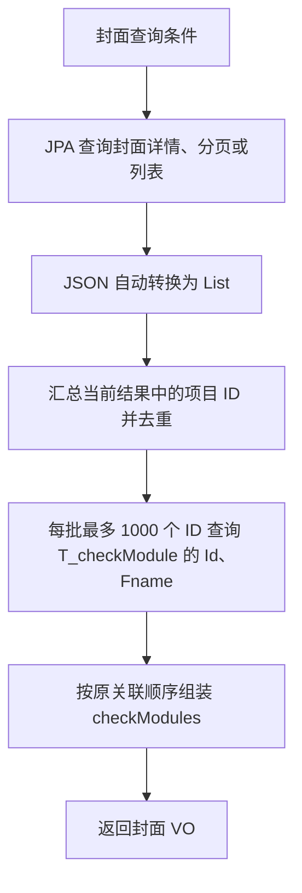

# 报告封面信息维护设计方案

更新日期：2026-11-12。本文按当前后端实现编写。

相关文档：[接口说明](报告封面信息维护接口说明.md)。部署脚本：[建表脚本](../sql/20261112_report_cover_info.sql)、[操作角色初始化脚本](../sql/20261112_report_cover_info_roles.sql)。

## 1. 目标与业务规则

维护报告封面使用的检测项目名称、样品要求、设备、检测依据等基础信息，解决报告展示名称与系统检测项目名称不一致的问题。初始字段参考用户提供的“报告封面信息汇总.xlsx”，本期实现后端 CRUD，不包含 Excel 导入、前端页面、封面文件生成或历史报告快照。

### 1.1 配置与检测项目关系

- 一条封面配置只有一个 `coverName`，去除首尾空白后全表唯一，唯一性比较遵循数据库排序规则。
- 一个封面名称可以关联多个系统检测项目；一个系统检测项目只能关联一条封面配置。
- 关联目标为旧系统 `T_checkModule.Id`，名称读取 `T_checkModule.Fname`，与另一张 `check_module` 表区分。
- 如果原始资料一行中实际包含多个独立封面名称，维护时拆成多条配置；相同的设备、依据等信息分别保存在各自记录中。不得通过通用标点自动拆分名称。
- 禁用配置仍占用关联项目。解除关联或物理删除配置后，项目才能关联其他封面。
- `itemCode` 只表示项目代码，允许为空、允许重复，不作为关联标识。
- 名称唯一与项目唯一归属均为全局规则，不按版本、分类或归属分别放宽。

### 1.2 列表内容

检测设备、检测依据各保存一个字符串列表，每项为完整展示文本，保留型号、标准号及备注，不关联设备库或标准库，不建立子表。关联检测项目 ID 也以单字段列表保存。

列表项不能为 null、空字符串或纯空白；保存时去除首尾空白。设备和标准保留顺序及重复项，项目 ID 去重并保留首次出现顺序。未传列表、传 null 或空数组，均保存为 `[]`。

## 2. 数据结构

表名：`dbo.report_cover_info`。一条记录对应一套封面配置，实体为 `ReportCoverInfo`。

### 2.1 业务字段

| 数据库字段 | Java / JSON 字段 | SQL Server 类型 | 必填 / 默认值 | 业务含义 |
| --- | --- | --- | --- | --- |
| `id` | `id` | `VARCHAR(36)` | 主键，UUID | 配置标识 |
| `cover_name` | `coverName` | `NVARCHAR(256)` | 必填、唯一 | 封面检测项目名称 |
| `check_module_ids` | `checkModuleIds` | `NVARCHAR(MAX)` | 非空，默认 `[]` | `T_checkModule.Id` 数组，单项最长 50 字符 |
| `item_code` | `itemCode` | `NVARCHAR(64)` | 可空 | 项目代码 |
| `sample_spec` | `sampleSpec` | `NVARCHAR(500)` | 可空 | 样品规格，包含原始单位文字 |
| `sample_status` | `sampleStatus` | `NVARCHAR(200)` | 可空 | 样品状态 |
| `instruments` | `instruments` | `NVARCHAR(MAX)` | 非空，默认 `[]` | 检测设备完整文本数组 |
| `standards` | `standards` | `NVARCHAR(MAX)` | 非空，默认 `[]` | 检测依据完整文本数组 |
| `category` | `category` | `NVARCHAR(64)` | 可空 | 业务分类 |
| `version` | `version` | `NVARCHAR(32)` | 可空 | 业务版本文本，例如 2026 |
| `ownership` | `ownership` | `NVARCHAR(128)` | 可空 | 归属 |
| `remark` | `remark` | `NVARCHAR(1000)` | 可空 | 备注 |
| `status` | `status` | `INT` | 非空，默认 1 | 0 禁用、1 启用 |

Java 中三个列表字段均为 `List<String>`，使用显式 JPA 转换器 `ReportCoverStringListConverter` 与 JSON 文本互转。单独使用该转换器是为了保证空列表保存为 `[]`，不改变其他模块已有的列表转换规则。

`version` 为业务资料版本，不是 JPA 乐观锁字段；当前更新不提供乐观锁冲突检测。

### 2.2 通用审计

实体直接继承 IPMS 现有的 `com.abt.common.model.AuditInfo`，实现 `CommonJpaAudit`，使用现有 JPA 审计机制和 `CommonJpaAuditListener`，不另外定义审计字段或监听逻辑。

| 数据库字段 | Java / 返回字段 | SQL Server 类型 |
| --- | --- | --- |
| `create_date` | `createDate` | `DATETIME2(0)` |
| `create_userid` | `createUserid` | `VARCHAR(255)` |
| `create_username` | `createUsername` | `VARCHAR(255)` |
| `update_date` | `updateDate` | `DATETIME2(0)` |
| `update_userid` | `updateUserid` | `VARCHAR(255)` |
| `update_username` | `updateUsername` | `VARCHAR(255)` |

请求对象不包含审计字段。更新仅复制业务字段，保留原创建信息，更新时间与更新人交给现有审计机制填写。时间返回格式为 `yyyy-MM-dd HH:mm:ss`。

### 2.3 约束与索引

- `PK_report_cover_info`：`id` 聚集主键。
- `UQ_report_cover_info_cover_name`：`cover_name` 唯一约束，作为名称唯一性的数据库兜底。
- `CK_report_cover_info_cover_name`：名称不能是空字符串或普通空格组成的字符串；接口另有非空校验。
- `CK_report_cover_info_status`：状态只能为 0、1，Java 使用 `ReportCoverStatus` 枚举定义。
- `IX_report_cover_info_create_date`：`create_date DESC, id DESC`，匹配默认列表排序。

JSON 内项目 ID 无法建立普通外键或唯一索引，因此项目存在性、唯一归属由应用事务内校验。不得把 JSON 字段保存成功等同于数据库已提供关系完整性约束。

## 3. 后端分层与接口

调用关系为 `ReportCoverInfoController → ReportCoverInfoService → ReportCoverInfoServiceImpl → Repository`。

- Controller：接收专用请求对象、执行中文参数校验、校验编辑和删除权限，返回现有 `R<T>`。
- Service：定义详情、分页、列表、新增、更新、删除六个业务方法。
- ServiceImpl：处理事务、关联规则、列表规范化、查询结果组装和关键操作日志。
- Repository：JPA 封面访问、旧系统项目摘要查询，以及数据库事务锁访问；不处理业务决策。
- Model：新增与更新使用 `ReportCoverInfoRequest`；查询使用继承 `RequestForm` 的 `ReportCoverInfoRequestForm`；返回使用 `ReportCoverInfoVO` 和 `ReportCoverCheckModuleVO`。

| 方法 | 完整路径 | 行为 | 操作权限 |
| --- | --- | --- | --- |
| GET | `/report-cover-info/findById` | 按 ID 查询详情 | 系统认证 |
| GET | `/report-cover-info/findPage` | 条件分页查询 | 系统认证 |
| GET | `/report-cover-info/findList` | 条件列表查询 | 系统认证 |
| POST | `/report-cover-info/save` | 新增，不接收客户端 ID | 系统认证 |
| POST | `/report-cover-info/update` | 按 ID 全量更新 | `JS_REPORT_COVER_EDIT` |
| DELETE | `/report-cover-info/delete` | 按 ID 物理删除 | `JS_REPORT_COVER_DEL` |

编辑、删除沿用 `@Secured` 和现有角色 ID 作为 authority 的校验方式，两个权限相互独立。角色通过初始化脚本创建，再由现有用户角色管理分配；用户重新登录刷新权限。不在初始化脚本中自动授权用户。

接口请求与响应样例见[接口说明](报告封面信息维护接口说明.md)。

## 4. 核心处理流程

### 4.1 新增与编辑

1. Controller 执行校验；新增禁止传 ID，编辑要求 ID 非空。编辑还需通过专属权限校验。
2. ServiceImpl 开启写事务，获取封面写操作的数据库应用锁。
3. 编辑时查询原记录；记录不存在则抛出 `BusinessException`。
4. 构造候选业务数据，规范化名称和列表，检查状态、名称唯一性、项目存在性及唯一归属。编辑时排除当前记录。
5. 校验通过后新增记录，或将候选业务数据复制到原记录并保存；由现有机制填充审计信息。
6. 补充关联项目当前名称，返回 VO，事务结束释放锁。发生异常则回滚。

编辑先校验独立候选对象，再修改托管实体，防止 Hibernate 在后续查询前自动 flush 未通过校验的字段。

更新采用全量覆盖：未传可选文本清空，未传列表清空；未传状态或状态为 null 默认启用。调用方编辑时应提交完整业务字段。

### 4.2 查询与关联名称回填

分页先在数据库完成，再补充当前页关联名称，不展开一对多数据，不改变主记录数量和分页总数。查询只读取旧项目表的 ID、名称，避免加载其余字段。

返回保留 `checkModuleIds`，另提供 `checkModules: [{id, name}]`，名称每次从项目表读取，不保存名称快照。旧系统从外部删除项目时，查询仍保留关联 ID，名称为 null；再次保存时需要解除或修正无效关联。

查询支持封面名称、项目代码模糊匹配，分类、版本、归属、状态精确匹配，条件之间为 AND。不传状态返回全部状态。分页页码从 1 开始，默认每页 20 条，上限 999 条，排序为 `createDate DESC, id DESC`。列表接口不分页。

本期不支持按关联项目名称筛选封面。不能在主记录分页后用关联名称过滤结果，否则分页总数和结果不一致。

### 4.3 物理删除

通过删除权限校验后，在写事务中获取相同应用锁，查询配置是否存在，执行实体物理删除并 flush，记录配置 ID 日志。提交后其关联项目可被其他配置使用。不存在的记录返回业务异常。

### 4.4 并发一致性

JSON 归属检查采用“读已有配置并在程序内比较 ID”的方式，因此新增、编辑、删除必须使用同一个数据库锁：

| 项目 | 配置 |
| --- | --- |
| 机制 | SQL Server `sys.sp_getapplock` |
| 资源名 | `ipms.report_cover_info.write` |
| 锁模式 | `Exclusive` |
| 锁归属 | `Transaction` |
| 等待时间 | 10000 毫秒 |
| 释放时机 | 事务提交或回滚 |

锁可协调使用同一数据库的多个应用实例。取锁失败时返回“报告封面配置正在被修改，请稍后重试”，不执行后续写入。JPA 与 JdbcTemplate 必须共用同一数据源和事务。

当前写入归属检查扫描已有配置，适合基础配置维护规模。直接写数据库、外部删除项目等行为不受该应用流程完整保护。若后续出现大规模配置或频繁按关联项目筛选的需求，应重新评估关联表方案。

两个编辑请求会依次执行，但本期没有版本冲突检测，后提交的完整数据可能覆盖先提交的修改。

## 5. 部署与验证

### 5.1 部署步骤

1. 在目标业务数据库执行建表脚本；脚本仅在表不存在时创建，不负责修正已存在但结构不同的表。
2. 执行角色初始化脚本，为指定用户分配编辑、删除权限。
3. 发布后端，确认应用账号具备获取应用锁的能力，JPA 与 JdbcTemplate 使用同一数据源和事务。
4. 用户重新登录，验证授权与未授权账号的操作结果。

脚本以 SQL Server 2014 为兼容目标，不使用 `OPENJSON`、`ISJSON`、`STRING_SPLIT` 等新版能力；JSON 在 Java 中转换。当前仅提供脚本，尚未在本任务中执行数据库变更。

### 5.2 已完成验证

- 业务测试：名称去空白与唯一性、同项目跨配置占用、禁用配置占用、项目不存在、解除关联、审计创建信息保留、物理删除及取锁失败阻止写入。
- 查询测试：当前名称回填、缺失项目保留 ID、分页信息保留、去重批量查询及超过 1000 个 ID 时拆批。
- 参数与转换测试：新增/编辑校验分组、字段长度、列表空项、非法状态、中文型号和换行等 JSON 往返转换、损坏 JSON 不静默丢弃。
- 权限测试：使用真实 Spring 方法权限代理验证未认证、无关角色、仅编辑权限、仅删除权限，未授权操作不会进入业务服务。

当前新增的 24 项测试分别在基础功能和权限修改后通过，未运行连接实际数据库的集成测试。

### 5.3 数据库联调待验证

- 建表脚本及角色脚本在实际目标数据库的执行结果。
- 实际登录用户的创建、更新审计信息填充。
- 多实例或多连接同时关联同一项目时最多一个成功，失败事务不遗留修改。
- 应用锁超时、提交释放、回滚释放，以及项目解除关联/删除后的再次关联。

这些验证属于后续数据库联调，不代表当前已在 SQL Server 2014 或本地 2022 完成运行验证。
