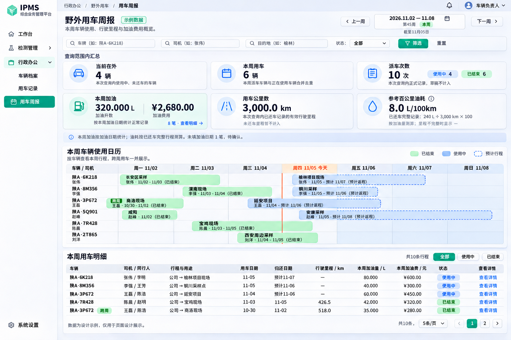

# 野外用车周报页面设计与数据定义

版本：V1.0  
日期：2026-11-05  
用途：供产品、前端、后端及测试对照实施。  
状态：页面方案已确认；本文仅记录设计与数据口径，不代表周报接口或页面已经实现。

## 1 页面目标

周报的主要目的是查看本周用车情况：哪些车辆仍在外、涉及多少辆车、派车多少次、加了多少升油和花费多少钱，以及有效行驶里程和参考百公里油耗。

页面以查询和查看详情为主，使用“查询条件 → 汇总数据 → 车辆使用日历 → 用车明细”的顺序。派车、还车、编辑加油和删除等业务操作继续在原有业务入口完成，不作为周报主操作。

本文中的“本周”均指页面当前选择的自然周。设计图默认展示 2026-11-02 至 2026-11-08，图内金额、车辆、姓名和行程均为示例。

## 2 已确认设计图

[查看原尺寸设计图](images/field-vehicle-weekly-report-v3.png)

图中文字或示例数值与本文统计定义存在歧义时，以本文定义为准。设计图查询栏中的司机、目的地输入框不实现，查询条件只有周、车牌和状态。

## 3 页面结构和交互

### 3.1 页头与查询条件

页头展示“野外用车周报”、查询周的起止日期、周次，以及数据查询时点。提供上一周、下一周和周选择控件，默认进入当前自然周。

查询条件放在汇总卡片上方，作用于汇总、日历、列表以及加油明细。查询成功后，各区域必须使用同一组生效条件和同一数据查询时点；不能出现汇总已更新、日历仍为旧条件的情况。

| 查询项 | 页面规则 | 与已有能力的关系 |
| --- | --- | --- |
| 查询周 | 周一至周日，包含首尾日期；按业务时区 Asia/Shanghai 划分 | 周报专用日期口径，不能直接等同于现有列表的用车日期筛选 |
| 车牌 | 支持输入或选择车辆，以车辆标识限定记录 | 可复用车辆选项查询；现有列表支持 carId |
| 状态 | 全部、使用中、已结束；不提供草稿 | 状态值沿用现有枚举 |
| 筛选 | 提交条件，刷新全部区域，明细回到第一页 | 不能只刷新列表 |
| 重置 | 清空车牌和状态条件，保留已选择的周，重新查询 | 返回当前周通过周选择控件完成 |

下方状态切换与上方状态条件保持同步，使用同一个生效状态，避免两个状态条件互相叠加。所有汇总均基于查询范围内的全部命中记录，不限于当前列表页。

### 3.2 上方汇总布局

采用两行三列卡片：第一行为“当前在外、本周用车、派车次数”；第二行为“本周加油、用车公里数、参考百公里油耗”。

“本周加油”卡片并列突出展示加油升数和加油费用，不能只展示金额。辅助显示加油笔数及“查看明细”入口。油耗卡片保留“参考”字样，并提供计算口径说明。

### 3.3 本周车辆使用日历

按车辆展示周一至周日的行程，左侧固定车牌和司机信息。同一辆车一周发生多次行程时展示多个独立行程块，不把多次派车合并成一次。人员信息取具体行程，不把行内某一个司机视为该车全周固定司机。

| 视觉元素 | 定义 |
| --- | --- |
| 绿色实线行程 | 已结束记录，范围为实际用车日期至实际结束日期，与查询周取交集 |
| 蓝色实线行程 | 使用中记录，自实际用车日期起展示至查询时点所在日，与查询周取交集 |
| 蓝色虚线行程 | 使用中记录的预计后续行程，依据 expectedReturnDate 展示，不能画成实际用车 |
| 今天标记 | 标记业务时区的当前日期，只有当前日期落在查询周内时显示 |
| 跨周标记 | 行程实际开始早于查询周，或实际／预计结束晚于查询周；只截取周内可见部分 |
| 悬停提示 | 展示车牌、司机、同行人、用途、出发地、目的地、实际开始日期、实际／预计归还日期及状态 |
| 点击行程 | 查看该次用车详情，不进入编辑 |

未填写预计返回日期时，不填造一个预计结束日期；使用中实线展示到查询时点，提示“预计归还未填写”。预计归还日期已经过去但仍未还车时，继续按使用中显示，不自动结束记录。

日历展示查询范围内全部车辆和行程，可在区域内滚动；不能跟随下方列表翻页而只显示当前页车辆。未来日期不展示为已发生的实际用车。

### 3.4 本周用车明细

一行对应一次正式用车记录，以用车主记录 ID 唯一识别；不是一辆车一行，也不是一次加油一行。

| 列 | 数据及展示规则 |
| --- | --- |
| 车辆 | carNo；存在跨周情况时显示跨周标记 |
| 司机／同行人 | drivers、peers 原样展示；同行人为空显示“—” |
| 行程与用途 | departurePlace → destination，辅助展示 purpose |
| 用车日期 | useDate，采用实际业务日期，不使用创建时间代替 |
| 归还日期 | 已结束显示 endDate；使用中显示“预计 + expectedReturnDate”，无预计日期显示“未填写” |
| 行驶里程／km | 已结束且里程有效时显示 usedMileage；使用中显示“—” |
| 本周加油量／L | 该行程内、加油日期落在查询周的正常加油明细升数之和 |
| 本周加油费／元 | 与本周加油量使用同一批加油记录的金额之和 |
| 状态 | 使用中、已结束 |
| 查看详情 | 打开该次用车完整详情及其全部加油明细，明确区分本周小计与整次行程累计 |

列表提供分页，默认按 useDate、createDate、id 降序，沿用现有列表排序含义。翻页不重新定义汇总范围；页面展示“共 N 条行程”。设计图每页 5 条仅用于示意，实现可沿用现有分页配置。

### 3.5 加油明细

点击“查看明细”，查看本周加油卡片对应的记录：加油日期、车牌、所属行程、加油升数、加油费用和说明。列表按 fuelDate、id 排序，全部记录汇总与卡片一致。

未填写加油日期的记录单独显示待确认笔数及查看入口；不得混入本周正常加油明细，不得用创建日期自动替代加油日期。查看整次行程时可以看到这些记录及其累计值。

## 4 统计范围定义

### 4.1 时间与状态

查询周起始日记为 Wstart，结束日记为 Wend；日期字段使用包含两端的区间。查询时点记为 T，用于说明“当前在外”是查询时刻的当前状态。

| 状态 | 现有值 | 是否属于周报正式记录 |
| --- | --- | --- |
| 草稿 | 0 | 否，不占车，不计派车和加油 |
| 使用中 | 1 | 是 |
| 已结束 | 2 | 是 |

“正常加油记录”在当前数据模型中指数据库中实际存在、关联正式用车记录的有效加油明细。现有加油实体没有独立状态或作废字段；不能自行假设 status、isDeleted 等列。已物理删除的记录自然不再参与统计；孤立或非法数据不静默当作正常数据。

### 4.2 查询集合

为避免跨周遗漏，先应用车牌、状态等已生效条件，再构造以下正式行程集合。相同主记录在并集中按 id 去重。周报不提供司机、目的地筛选。

| 集合 | 定义 |
| --- | --- |
| D 本周派车行程 | useDate 在 Wstart 至 Wend 内的正式记录 |
| U 当前使用中行程 | status 为使用中、endDate 为空且 useDate 不晚于 Wend 的记录；可以早于本周开始 |
| C 跨周结束行程 | useDate 早于 Wstart、endDate 不早于 Wstart 的已结束记录 |
| R 周报行程 | D、U、C 的并集；作为派车次数、日历和用车明细的完整行程范围 |

例如，一条上周开始、本周结束的行程属于 C，应出现在日历和明细；一条上周开始、当前仍在使用的行程属于 U，不能因用车日期不在本周而被漏掉。若出现“使用中但已有实际结束日期”等状态矛盾数据，应提示数据异常，不直接作为正常在外车辆统计。

本周用车卡片按 D 与 U 的车辆并集计算，遵循用户确认的“本周派车 + 正在使用”定义；仅属于 C 的车辆不会因此单独增加该卡片数量。因此，日历全部车辆数与本周用车卡片可能不同，两者不能互相替代。

选择历史周时，U 仍按查询时点的实际 status 判断，并限制 useDate 不晚于该周末。“当前在外”不代表“历史周末在外”；界面应保留“截至查询时点”说明。根据现有数据不能把当前状态直接宣称为历史状态快照。

## 5 汇总指标定义

| 指标 | 统计对象和计算方式 | 单位及图中示例 |
| --- | --- | --- |
| 当前在外 | U 中按 carId 去重的车辆数；必须为使用中且未还车 | 辆；4 |
| 本周用车 | D 与 U 合并后按 carId 去重；同车本周多次派车、或同时满足两个条件，只计一辆 | 辆；6 |
| 派车次数 | R 中主记录数；等于 R 内使用中次数加已结束次数，不含草稿 | 次；10，其中使用中 4、已结束 6 |
| 本周加油量 | 所属主记录在 R 内，fuelDate 在查询周内的正常明细，汇总 fuelQuantity | L；320.000 |
| 本周加油费用 | 与本周加油量完全相同的明细，汇总 amount | 元；2,680.00 |
| 本周加油笔数 | 与本周加油量完全相同的明细，按加油明细 id 计数；同日多笔分别计数 | 笔；8 |
| 用车公里数 | R 内已结束且实际起止里程完整、有效的记录，汇总 usedMileage；零公里可以计入里程汇总 | km；3,000.0 |
| 参考百公里油耗 | 对 R 内满足下述完整行程条件的记录，先分别合计整次行程加油量和行驶里程，再计算升数 ÷ 公里数 × 100 | L/100km；8.0 |

派车次数按查询内正式行程统计，包含跨周行程，不等于只统计本周 useDate 的 D 数量。示例中本周实际开始 9 次，另有一条上周开始、本周结束的行程，因此派车次数为 10 次。

### 5.1 本周加油的归属

本周加油严格按 fuelDate 归属，不能用主记录 useDate、endDate 或加油创建时间替代。使用中和已结束行程均可贡献本周正常加油。跨周行程只计算周内加油，不把整次行程全部加油放进本周。

fuelDate 为空的明细不纳入本周加油量、费用和笔数；在 R 内单独统计待确认笔数。它们仍参与所属行程已有的整次加油累计，此行为与现有业务保持一致。

主表 fuelTotalQuantity、fuelTotal、fuelCount 是整次行程的累计值，包含不同周和未填写日期的有效明细，不能直接相加作为本周加油指标。周内指标必须根据实际加油明细日期另行统计。

### 5.2 行驶里程的有效性

用车公里数取已结束行程的实际里程差，业务含义为 endMileage − startMileage，并优先复用现有 usedMileage。使用中记录没有最终 endMileage，不能显示为 0，也不能用预计返回日期推算公里数。

主记录已结束、起止里程均存在且结束里程不小于起始里程时，可参与公里数汇总。缺失或矛盾的数据作为异常提示，不以 0 替代后悄悄合计。

跨周已结束行程按完整行程公里数统计，不按天数平均拆分。现有数据没有逐日里程或周初周末里程，不能声称该数字是精确的“本周实际行驶公里数”。因此卡片命名为“用车公里数”，辅助说明“本次查询内已还车记录的有效行驶里程”。

### 5.3 参考百公里油耗

油耗采用完整行程口径。参与油耗计算的每条记录必须已结束、实际里程完整且大于 0，并有正常有效的加油记录。无加油记录的行程不能直接认定为零油耗，不参与本项测算；仍可参与有效公里数卡片。

计算方法：参考百公里油耗 = 参与测算行程的累计加油升数之和 ÷ 同一批行程的实际行驶公里数之和 × 100。

累计加油升数取这些行程全部有效加油记录，包括行程内不同周以及日期为空的加油；这与“本周加油量”按周内日期统计是不同口径。油耗的分子和分母必须来自完全相同的行程集合，不能把全部本周加油量除以已还车的部分里程，也不能对每次行程油耗直接做算术平均。

图中示例为 240 L ÷ 3,000 km × 100 = 8.0 L/100km。320.000 L 是本周正常加油量，包含未还车等行程；240 L 才是参与示例油耗测算的已还车完整行程累计加油量，两者不要求相等。

由于加油量不等于真实耗油量，页面始终标注“参考百公里油耗”和“按加油量测算”。没有满油到满油或油箱余量数据时，不称为实际油耗。没有可测算行程、分母为 0、或相关数据加载失败时，油耗显示“—”并说明原因。

如果部分已结束行程缺少加油或里程，提示“仅统计完整行程”及参与测算数量。油耗所用里程可能小于公里数卡片；口径说明中应展示实际测算分子和分母，不能强行套用公里数卡片的总值。

## 6 字段与现有数据来源

以下是已存在的业务字段，位置以当前代码为依据。页面展示的周内合计和油耗属于派生数据，不要求在数据库中新增同名列。

| 业务数据 | 现有 Java 字段 | 来源及用途 |
| --- | --- | --- |
| 行程标识 | id | FieldVehicleListVO，行程去重和明细跳转 |
| 车辆标识及车牌 | carId、carNo | FieldVehicleListVO，车辆去重使用 carId，展示使用车牌快照 |
| 人员 | drivers、peers | FieldVehicleListVO，完整姓名文本 |
| 行程信息 | purpose、departurePlace、destination | FieldVehicleListVO，仅展示，不作为查询条件 |
| 用车及预计归还 | useDate、expectedReturnDate | FieldVehicleListVO，日历实际开始和预计结束 |
| 实际结束 | endDate、returnTime | FieldVehicleListVO；endDate 是业务结束日期，returnTime 是实际还车操作时间，不混用 |
| 起止及行驶里程 | startMileage、endMileage、usedMileage | FieldVehicleListVO，已结束行程里程 |
| 状态 | status、statusName | FieldVehicleListVO；取值 0、1、2 |
| 整次行程加油累计 | fuelTotalQuantity、fuelTotal、fuelCount | FieldVehicleListVO，用于整次详情及完整行程参考油耗 |
| 加油明细关联 | id、mainId | FieldVehicleFuelVO；实体关联数据库列为 m_id |
| 加油业务日期 | fuelDate | FieldVehicleFuelVO，可空；周内统计的日期依据 |
| 加油数量和金额 | fuelQuantity、amount | FieldVehicleFuelVO；分别为升和元 |
| 加油说明 | remark | FieldVehicleFuelVO，可空 |
| 完整加油集合 | fuelItems | FieldVehicleDetailVO，整次用车详情内的加油明细 |

### 6.1 周报派生数据建议

下表只是应用层输出的语义建议，不是已存在的接口字段，不构成已实现的 API 契约。实施时应使用明确 DTO／VO，不向前端返回 Map，也不直接暴露实体。

| 派生数据 | 类型与约束 |
| --- | --- |
| 查询周起止日期及查询时点 | 日期、时间；明确业务时区 |
| 当前在外车辆数、本周用车车辆数 | 非负整数，按 carId 去重 |
| 派车总次数、使用中次数、已结束次数 | 非负整数，总数等于后两项之和 |
| 本周加油升数、费用、笔数 | 十进制数、十进制数、非负整数；共同使用同一批周内明细 |
| 待确认加油日期笔数 | 非负整数，限定在 R 内 |
| 有效公里数、有效行程数及异常数 | 十进制数及非负整数，便于解释统计覆盖范围 |
| 参考油耗及其测算升数、测算公里数、测算行程数 | 可空十进制数及非负整数；油耗不可算时为空而不是 0 |
| 每条行程的本周加油升数和费用 | 派生小计，与页头同口径，不替换整次行程累计字段 |

### 6.2 精度与空值

数量、金额和里程计算使用十进制数，先按原始精度累计，再在展示时舍入。不得通过逐条显示值反向汇总。

| 数据 | 展示方式 |
| --- | --- |
| 车辆数、次数、笔数 | 整数 |
| 加油量 | 3 位小数，单位 L |
| 金额 | 2 位小数；卡片带 ¥，表头明确元 |
| 公里数 | 1 位小数，单位 km；源数据精度不被展示规则覆盖 |
| 参考百公里油耗 | 1 位小数，单位 L/100km |
| 业务日期 | 完整值 yyyy-MM-dd，周内日历可简写 MM/dd |
| 查询时点 | yyyy-MM-dd HH:mm:ss |
| 确实没有记录 | 可加总项显示 0、0.000、0.00；参考油耗显示“—” |
| 未知、不可计算或加载失败 | 显示“—”、错误提示或重试入口，不显示成真实零值 |

## 7 与现有接口的边界

当前已有 `/field-vehicle/findPage`、`/field-vehicle/findById` 和 `/field-vehicle/car/findList` 等接口，具体参数参见[野外用车后端接口说明](野外用车接口说明.md)。本文不修改这些接口，也不预设一个已经存在的周报 URL。

现有 findPage 的起止日期按 useDate 筛选，直接传本周日期会漏掉跨周使用中和跨周归还记录；它返回的加油三项累计是整次行程口径，也不能直接作为本周加油。周报还需要独立的日期归属统计、完整查询范围的汇总和日历数据。查询条件只有周、车牌和状态，不提供司机、目的地筛选。实施前需根据本文补齐相应服务能力和接口定义。

汇总应由后端按完整查询范围计算；前端不通过逐页请求后求和，也不对当前页做全量统计。日历和列表可以分开返回，但必须共享查询口径。避免逐条调用详情接口查询加油形成大量请求。

后续实现遵循 controller → service → repository，业务汇总在 serviceImpl 编排。主表分页不展开一对多加油明细；需要从表筛选时优先 EXISTS，当前页明细批量查询并控制 IN 参数数目。涉及原生 SQL 时以 SQL Server 2014 为兼容基准。这里仅记录实现约束，不提供或执行数据库变更。

## 8 数据更新与异常展示

查询应提供统一的数据查询时点。汇总、日历和列表发生并发更新时，应保证一致性或明确说明各区域的更新时间，避免“使用中次数 + 已结束次数”不等于派车次数。

进行中的加油和还车操作成功后，重新进入或刷新周报时获取最新数据。已结束行程遵循已有冻结规则，周报本身不提供修改入口。

空结果时，汇总显示正确的零值和不可计算的油耗，日历与明细展示空状态。请求失败时展示重试，不能将失败伪装成零记录。切换周或筛选时显示加载状态，旧数据不得继续标注为新周数据。

## 9 验收场景

| 场景 | 预期结果 |
| --- | --- |
| 同一车本周派出并结束 3 次 | 本周用车计 1 辆，派车次数计 3 次 |
| 同一车既有本周已结束行程，又有当前使用中行程 | 本周用车仍只计 1 辆，当前在外计 1 辆 |
| 上周派车，当前仍未还车 | 纳入 U、当前在外、本周用车、派车次数及日历 |
| 上周派车，本周归还 | 纳入 C、派车次数、日历和明细；仅凭此行程不增加 D 与 U 的车辆并集 |
| 草稿日期在本周 | 不纳入汇总、日历、明细和油耗 |
| 一条跨周行程有上周加油 100 元、本周加油 300 元 | 本周加油费用仅计 300 元；整次累计仍可为 400 元 |
| 同日有两笔正常加油 | 金额和升数均逐笔合计，加油次数计 2 笔 |
| 加油日期为空，创建日期在本周 | 不计入本周加油，计入待确认笔数；整次行程累计仍保留 |
| 加油日期恰为查询周周一或周日 | 都纳入；下一周周一不纳入 |
| 使用中已加油但没有还车里程 | 本周加油正常计入；该行程不参与公里数和参考油耗 |
| 已结束行程无加油记录 | 有效公里数可计入；不能据此显示该行程油耗为 0 |
| 完整行程加油合计 240 L，里程合计 3,000 km | 参考油耗为 8.0 L/100km，不使用本周全部 320 L 替代分子 |
| 本次查询全部有效里程为 0 | 油耗显示“—”，无除零或无穷大 |
| 明细翻页 | 上方汇总和日历不因当前列表页改变 |
| 状态切换为已结束 | 同步全部区域；当前在外为 0，派车次数等于已结束次数 |
| 切换历史周 | “当前在外”仍标注查询时点当前状态，不声称历史周末占用快照 |
| 数据加载失败 | 显示错误与重试，不用 0 冒充加载成功 |

## 10 设计依据与交付范围

设计依据为本次对话确认的最新版页面图，以及现有 `FieldVehicleListVO`、`FieldVehicleDetailVO`、`FieldVehicleFuelVO`、`FieldVehicleFuel`、`FieldVehicleRequestForm` 和[野外用车后端接口说明](野外用车接口说明.md)。

本次交付仅包含本文和随附设计图。没有修改业务代码、接口、数据库结构或现有业务记录；文档中的周报能力和派生数据仍需后续实现与验证。
